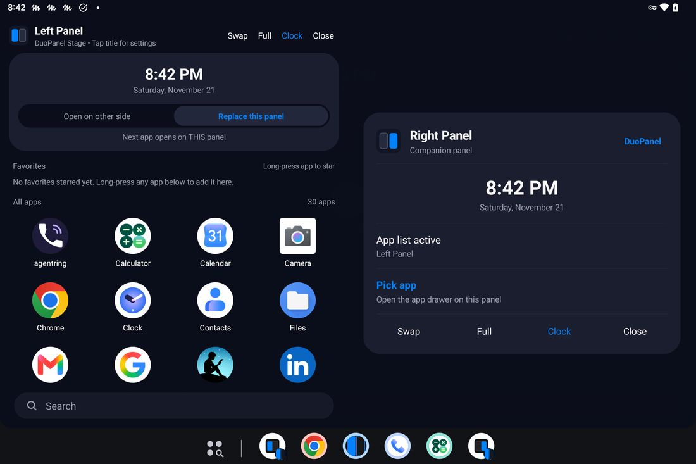
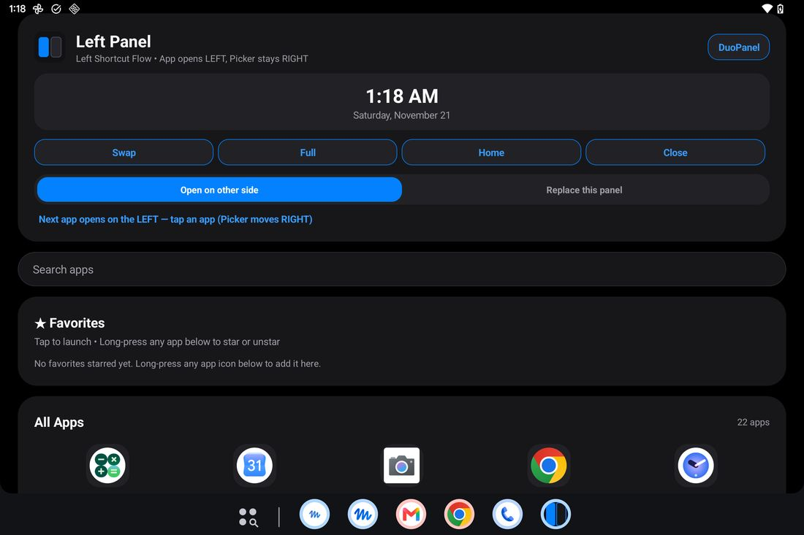

# DuoPanel (`com.jonathancruzate.duopanel` v0.1.2)

**One-panel-by-default app launching and a Samsung One UI styled second-panel App Picker for Galaxy Z Fold 8.**

Surface Duo 1 had two logical displays: tapping an app filled one panel while the other panel held a second app or the app picker. The Galaxy Z Fold 8 has a single continuous inner display, so Samsung One UI opens apps full-screen by default. **DuoPanel** restores Surface Duo's one-panel ergonomics on top of **Samsung One UI Home** while keeping the **Samsung Taskbar** and system navigation intact.

- **Not a launcher** (does not request the `HOME` role; works *with* One UI Home)
- **No root, no Shizuku, no ADB required** for core operation
- **No `AccessibilityService`**
- **No `INTERNET` permission** (100% offline; zero telemetry, ads, or network calls; no data leaves the device)
- **Framework-only build** (`minSdk 29`, `targetSdk 36`, `compileSdk 36`, zero AndroidX dependencies)

---

## Default Behavior: Surface Duo Window Management

Out of the box, DuoPanel's default behavior mimics **Surface Duo window management** — **the app list lives on the panel the app is going to open on**:

- **The list opens on the target panel (`Left` → Left panel, `Right` → Right panel):**
  - Tap the **Left Panel** shortcut: the app list (`PickerActivity`) opens confined to the **LEFT** panel only, while the **RIGHT** panel shows the minimal One UI-styled **`CompanionPanelActivity`** surface.
  - Tap the **Right Panel** shortcut: `PickerActivity` opens confined to the **RIGHT** panel only, while the **LEFT** panel shows `CompanionPanelActivity`.
- **Picking an app replaces the Picker on its own panel (default mode):** Tapping an app in `PickerActivity` opens that app **on the Picker's own panel, replacing the Picker** (`"Replace this panel"` is preselected by default for corner-shortcut flows, with the hint: *"Next app opens on THIS panel"*). The companion stays on the other panel.
  - The alternate mode (**"Open on other side"**) remains available via the segmented mode toggle in the Picker if you ever want a pick to open on the opposite panel while keeping the Picker open.
- **Companion Panel (`CompanionPanelActivity`) on the free panel:** Shows the DuoPanel header, a live clock and date, the name and icon of the app on the other panel when known, and five controls:
  - **Pick app:** Summons `PickerActivity` on the companion's own panel (replacing the companion, with that panel as its side and `"Replace this panel"` preselected) so your second app is one tap away.
  - **Swap**, **Full**, **Clock**, **Close:** Behave identically to the same buttons in `PickerActivity` (**Clock** shows or hides the live clock and date block on that panel).
- **Span only via the `Full` button:** Apps never span both panels automatically; full-screen spanning happens only when you explicitly tap **Full** in the Picker or Companion header (or when on a folded cover / narrow display `< 600dp` with Split Mode on `Auto`).
- **Configurable in Settings:** If you ever want Solo shortcuts to launch without bringing up the free-panel Companion flow, you can turn off **DuoPanel → Settings → Picker on the free panel** (default **ON**).

---

## 1. Primary Setup: Left & Right Corner-Pin Shortcuts (One UI Home)

DuoPanel's primary entry points are two ready-made pinned shortcuts designed to sit in the bottom corners of your **One UI Home** screen so either thumb can open an app directly into its side of the display:

1. Open **DuoPanel** (`MainActivity`).
2. Tap **Add LEFT shortcut** (`Left Panel` — dual-panel icon with the **left** panel highlighted in One UI Blue `#0381FE`) and pin it to the **bottom-left corner** of One UI Home.
3. Tap **Add RIGHT shortcut** (`Right Panel` — dual-panel icon with the **right** panel highlighted in One UI Blue `#0381FE`) and pin it to the **bottom-right corner** of One UI Home.

*(You can also long-press the DuoPanel app icon on One UI Home to drag the static/dynamic `Left Panel` and `Right Panel` shortcuts straight to the bottom corners.)*

### How the Left & Right Corner Flows Work

Tapping either corner shortcut (`EXTRA_PANEL_ENTRY = LEFT` / `RIGHT`) immediately forms a split-screen panel pair with `PickerActivity` on the shortcut's panel and `CompanionPanelActivity` on the opposite panel, styled after Samsung One UI (`DESIGN-REFERENCE.md` & `PATCH-0.1.2B.md`: translucent frosted cross-window blur background on API 31+ darkened with a ~72% `#B80B0E1A` navy scrim — falling back gracefully to the translucent scrim or solid `#0B0E1A` where blur is unavailable, while Settings/Main/Launch Lab/About keep solid `#0B0E1A` backgrounds — plus `#1A1E2E` 26dp rounded grouped cards, Samsung blue `#0381FE` used only for links/selection/active states, drawer-style 4-column full-color app grid with 12sp white labels, Favorites top group above All apps, three-dot `⋮` floating rounded menu card, and a bottom `"Search"` pill with magnifier icon):

- **Left Panel Shortcut (`bottom-left corner` — Picker & App on LEFT, Companion on RIGHT):**
  1. `PickerActivity` (fullscreen at first frame) immediately launches `CompanionPanelActivity` with the existing adjacent-launch flags (`FLAG_ACTIVITY_NEW_TASK | FLAG_ACTIVITY_MULTIPLE_TASK | Intent.FLAG_ACTIVITY_LAUNCH_ADJACENT | FLAG_LAUNCH_ADJACENT_TO_RECENT` + guarded `WINDOWING_MODE_SPLIT_SCREEN_SECONDARY` reflection), guarded once per fresh shortcut open.
  2. `PickerActivity` stays in the **LEFT (primary)** panel and `CompanionPanelActivity` lands in the **RIGHT (secondary)** panel (logging `PANEL_PAIR_FORMED` side `LEFT`).
  3. `PickerActivity` preselects **Replace this panel** with the hint bar: *"Next app opens on THIS panel"*.
  4. Tapping an app launches it without adjacent flags (`FLAG_ACTIVITY_NEW_TASK | FLAG_ACTIVITY_MULTIPLE_TASK`, `REPLACE_PANEL_SLOT`) so it replaces `PickerActivity` on the **LEFT** panel while `CompanionPanelActivity` stays on the **RIGHT** panel (and updates to show the picked app's name).
  5. Tapping **Pick app** on `CompanionPanelActivity` replaces the companion with `PickerActivity` on the **RIGHT** panel so you can pick a second app for the right side.

- **Right Panel Shortcut (`bottom-right corner` — Picker & App on RIGHT, Companion on LEFT):**
  1. `PickerActivity` launches `CompanionPanelActivity` as a normal `NEW_TASK` primary (`FLAG_ACTIVITY_NEW_TASK | FLAG_ACTIVITY_CLEAR_TOP`), then uses the existing `AnchorActivity` re-anchor (`SoloLauncher.reanchorPicker`) to spawn a fresh `PickerActivity` adjacent on the **RIGHT** whose side is `RIGHT` and whose default mode is **Replace this panel**; the original `PickerActivity` finishes (logging `PANEL_PAIR_FORMED` side `RIGHT`).
  2. `CompanionPanelActivity` remains on the **LEFT** panel and `PickerActivity` occupies the **RIGHT** panel with the hint bar: *"Next app opens on THIS panel"*.
  3. Tapping an app replaces `PickerActivity` on the **RIGHT** panel while `CompanionPanelActivity` remains on the **LEFT** panel.
  4. If pair formation ever fails (or Split Mode does not engage for the current posture), `PickerActivity` simply stays fullscreen, logs `PANEL_PAIR_FAILED` with the reason, and lets you pick apps normally.

- **Picker & Companion Header Controls:**
  - **Pick app (Companion only):** Summons `PickerActivity` on the companion's own panel (replacing the companion) with `"Replace this panel"` preselected.
  - **Swap:** Relaunches the current pair on opposite panels.
  - **Full:** Relaunches the paired app full-screen and closes the Picker/Companion.
  - **Clock:** Toggles the live clock and date block on that panel.
  - **Close:** Closes the Picker or Companion panel so the remaining app can be dragged full-screen.

> **Portrait / Top-Bottom Orientation Note:** When the screen is in portrait top/bottom split orientation (such as on the Galaxy S24+ or a rotated inner display), **Left Panel** maps to the **Top (primary)** half and **Right Panel** maps to the **Bottom (secondary)** half. The dual-panel icons and labels still read naturally as first and second panel.

---

## 2. Secondary Setup: Per-App Solo Shortcuts & Two-App Pair Shortcuts

Below the Left & Right corner shortcut cards on DuoPanel's main screen are two secondary shortcut sections powered by `SoloTrampolineActivity` (`Theme.Translucent.NoTitleBar`, `excludeFromRecents="true"`, `taskAffinity=""`) and `SoloLauncher`:

### Per-App Solo Shortcuts
1. In **2. Per-App Solo Shortcuts**, tap **+ Add Left Solo App Shortcut** or **+ Add Right Solo App Shortcut** and pick any installed app (target: your top 10–20 daily apps such as Outlook, Chrome, YouTube, OneNote).
2. DuoPanel publishes a badged pinned shortcut (`ShortcutManager.requestPinShortcut` with a legacy `com.android.launcher.action.INSTALL_SHORTCUT` broadcast fallback) onto One UI Home.
3. By default (**Settings → Picker on the free panel = ON**), tapping a Solo shortcut when split engages pairs the target app with `CompanionPanelActivity` on the free panel (logging `SOLO_WITH_COMPANION` in **Launch Lab**):
   - **Left Solo shortcut (`side = LEFT`):** Launches the target app as primary (`FLAG_ACTIVITY_NEW_TASK | FLAG_ACTIVITY_CLEAR_TOP`), then uses `AnchorActivity` (`SoloLauncher.spawnAdjacentCompanionFromAnchor`) to spawn `CompanionPanelActivity` adjacent on the right panel paired with the target app.
   - **Right Solo shortcut (`side = RIGHT`):** Launches `CompanionPanelActivity` as primary (`FLAG_ACTIVITY_NEW_TASK | FLAG_ACTIVITY_CLEAR_TOP`) on the left panel, then uses `AnchorActivity` (`SoloLauncher.spawnAdjacentAppFromAnchor`) to spawn the target app adjacent on the right panel.
   - Tapping **Pick app** on `CompanionPanelActivity` replaces the companion with `PickerActivity` on that free panel whenever you want to launch a second app.
4. When **Picker on the free panel** is turned **OFF** in Settings (or when testing explicit strategies in **Launch Lab**), `SoloTrampolineActivity` tries DuoPanel's multi-window launch strategies in order (trying the per-package remembered winning strategy from `SharedPreferences` first, then **A → B → C → D**) and exits cleanly with `finishAndRemoveTask()`:
   - **Strategy A (Split-Adjacent Primary):** Launches the target app normally (`FLAG_ACTIVITY_NEW_TASK | FLAG_ACTIVITY_CLEAR_TOP`), then 110ms later launches `PickerActivity` with `adjacentLaunchFlags()` (`0x18101000`) + guarded `WINDOWING_MODE_SPLIT_SCREEN_SECONDARY` reflection.
   - **Strategy B (Target Split Flags + Picker Adjacent):** Launches the target app itself with `adjacentLaunchFlags()` + guarded `WINDOWING_MODE_SPLIT_SCREEN_PRIMARY` (mode 3) reflection, then 110ms later launches `PickerActivity` with `adjacentLaunchFlags()` + guarded mode 4 reflection.
   - **Strategy C (Freeform Half Bounds Fallback):** Launches the target app with `FLAG_ACTIVITY_NEW_TASK | FLAG_ACTIVITY_MULTIPLE_TASK` and public `ActivityOptions.makeBasic().setLaunchBounds(Rect)` sized to the left/right (or top/bottom in portrait) half of the screen, leaving windowing mode default (never combining `setLaunchBounds` with split windowing mode).
   - **Strategy D (Graceful Fullscreen Fallback):** Launches the target app normally full-screen (`FLAG_ACTIVITY_NEW_TASK | FLAG_ACTIVITY_CLEAR_TOP`) and shows a short toast: *"Split was refused for this app, opened full screen. You can save it as a native App Pair instead."* Never crashes, never loops.

### Two-App Pair Shortcuts
1. In **3. Two-App Pair Shortcuts**, tap **+ Create & Pin Two-App Pair Shortcut**, choose **App 1 (Left / Primary)** and **App 2 (Right / Secondary)**, and pin the Pair shortcut to One UI Home.
2. Tapping the Pair shortcut runs `SoloTrampolineActivity` (`ACTION_LAUNCH_PAIR`), which launches App 1 and App 2 side-by-side using the same strategy engine. If an app refuses Solo + Picker pairing, a direct two-app Pair shortcut provides an immediate fallback.

---

## 3. Honest Scope & Platform Limits

- **Curated Shortcuts Product — NOT a Universal System Default:**
  DuoPanel is a curated **Left/Right Panel, Solo, and Pair shortcuts** product. It does **not** claim to intercept all app launches across Android. Only launches initiated from DuoPanel's pinned shortcuts (or inside DuoPanel's Picker) trigger the one-panel split flow.
- **Native One UI Surfaces Still Open Full-Screen:**
  Real One UI Home icons in the app drawer, the Samsung Taskbar, Recents, notifications, and intents launched from inside other apps still open full-screen. That is an Android and Samsung platform limit without root or replacing the default launcher, and DuoPanel does not hide it.
- **Cover / Narrow Screen Posture Behavior (`< 600dp`):**
  When **Split Mode** is set to **Auto (Wide >= 600dp)** (the default for Galaxy Z Fold 8), tapping a Solo/Pair shortcut or picking an app on the folded cover screen (`< 600dp`) simply opens the target app normally full-screen. Split strategies engage automatically when unfolded (`>= 600dp`) or when **Split Mode** is set to **Always Try Split** (used for testing on the Galaxy S24+).
- **Hardware Gate Status:**
  v0.1.0 is built to prove the multi-window flag and re-anchor mechanics on real Samsung hardware—first using Galaxy S24+ split-screen as a proxy, and then on the Galaxy Z Fold 8 on arrival (Dec 2–4) as the real hardware gate.

---

## 4. Installing the APK

After building `app/build/outputs/apk/debug/app-debug.apk` (see `BUILD_NOTES.md`):

```powershell
# Install via ADB over USB or Wireless Debugging:
C:\Users\jonat\devtools\android-sdk\platform-tools\adb.exe install -r C:\Users\jonat\duo-panel\app\build\outputs\apk\debug\app-debug.apk
```

Or copy `app-debug.apk` to your device and install it with Samsung **My Files**.

---

## 5. Galaxy S24 Plus Split-Screen Test Steps

The Galaxy S24+ has a portrait screen width `< 600dp`, so **Split Mode = Auto** would treat it as a folded cover screen and open apps full-screen. Follow these steps to test split-screen on the S24+:

1. **Enable S24+ Always Split Mode:**
   Open **DuoPanel** and tap **Set S24+ Always Split** in the top Device Mode card (or go to the **Settings** tab → **Split Mode** → select **Always Try Split**).
2. **Pin the Left & Right Corner Shortcuts:**
   On the **Shortcuts & Pairs** tab, tap **Add LEFT shortcut** and **Add RIGHT shortcut**, and place `Left Panel` in the bottom-left corner and `Right Panel` in the bottom-right corner of One UI Home.
3. **Test the Left Panel Corner Flow (Top/Bottom Split on S24+ Portrait):**
   - Tap **Left Panel** on One UI Home. Verify `PickerActivity` opens on the primary (left/top) half while `CompanionPanelActivity` opens on the secondary (right/bottom) half (`PANEL_PAIR_FORMED` side `LEFT`), and the Picker hint bar reads: *"Next app opens on THIS panel"* with **Replace this panel** preselected.
   - Tap an app (e.g., Chrome). Verify Chrome replaces `PickerActivity` on the left/top half while `CompanionPanelActivity` remains on the right/bottom half and displays Chrome's name.
   - Tap **Pick app** on `CompanionPanelActivity` and verify `PickerActivity` replaces the companion on the right/bottom half. Pick a second app and verify it replaces the Picker on the right/bottom half.
4. **Test the Right Panel Corner Flow:**
   - Return to One UI Home and tap **Right Panel**.
   - Verify `CompanionPanelActivity` opens on the left/top half and `AnchorActivity` spawns a fresh `PickerActivity` on the right/bottom half (`PANEL_PAIR_FORMED` side `RIGHT`) with **Replace this panel** preselected and hint *"Next app opens on THIS panel"*.
   - Tap an app in the Picker and verify it replaces the Picker on the right/bottom half.
   - Test the **Pick app**, **Swap**, **Full**, **Clock**, and **Close** buttons on `CompanionPanelActivity` and `PickerActivity`.
5. **Test Per-App Solo & Pair Shortcuts:**
   - In **DuoPanel → Shortcuts & Pairs**, add a Solo shortcut for Chrome or YouTube and a Pair shortcut for two apps.
   - Tap the pinned Solo and Pair shortcuts from One UI Home and verify `SoloTrampolineActivity` launches the split without leaving a trampoline card in Recents.
6. **Run Launch Lab Diagnostics:**
   - Open **DuoPanel → Launch Lab**, pick a test app, and tap **Left Flow Test**, **Right Flow Test**, **Try Strategy A**, **Try Strategy B**, **Try Strategy C**, and **Try Normal (Strategy D)**.
   - Verify the **Attempt Log** records the timestamp, flow/strategy, side, target package, exact hex flag bitmask (`0x18101000 [NEW_TASK|MULTIPLE_TASK|LAUNCH_ADJACENT(0x1000)|LAUNCH_ADJACENT_TO_RECENT(0x100000,distinct=true)]`), `setLaunchWindowingMode` reflection probe status, and result.

---

## 6. Galaxy Z Fold 8 Arrival-Day Checklist (Dec 2–4)

Use this checklist when the Galaxy Z Fold 8 arrives:

- [ ] **1. Posture Gate Verification (`Split Mode = Auto`):**
  - [ ] Confirm **Settings → Split Mode** is set to **Auto (Wide >= 600dp)** (default).
  - [ ] **Folded cover screen (`< 600dp`):** Tap a Solo shortcut and pick an app from Left/Right Panel; confirm it opens normally full-screen (`COVER_FULLSCREEN` in Launch Lab log).
  - [ ] **Unfolded inner display (`>= 600dp`):** Confirm `screenWidthDp` / `smallestScreenWidthDp >= 600` in **Launch Lab** (`isWide=true`, `engage=true`) and split strategies engage automatically.
- [ ] **2. Bottom-Corner Pinning on Unfolded One UI Home:**
  - [ ] Pin **Left Panel** to the **bottom-left corner** of the unfolded One UI Home screen.
  - [ ] Pin **Right Panel** to the **bottom-right corner** of the unfolded One UI Home screen.
  - [ ] Verify **Left Panel** opens `PickerActivity` on the left panel + `CompanionPanelActivity` on the right panel (`PANEL_PAIR_FORMED` side `LEFT`), picking an app replaces the Picker on the left panel, and tapping **Pick app** on the right companion summons the Picker on the right panel.
  - [ ] Verify **Right Panel** opens `CompanionPanelActivity` on the left panel + `PickerActivity` on the right panel (`PANEL_PAIR_FORMED` side `RIGHT`), picking an app replaces the Picker on the right panel, and test the **Swap** button if sides ever need flipping.
- [ ] **3. Per-App Strategy Matrix in Launch Lab (Record Winning Strategy):**
  Open **DuoPanel → Launch Lab** on the unfolded inner display, test each target app across `Left Flow`, `Right Flow`, `Strategy A`, `Strategy B`, and `Strategy C`, and record which strategy worked:
  - [ ] **Microsoft Outlook** (`com.microsoft.office.outlook`) — Winning flow/strategy: `________________`
  - [ ] **Google Chrome** (`com.android.chrome`) — Winning flow/strategy: `________________`
  - [ ] **YouTube** (`com.google.android.youtube`) — Winning flow/strategy: `________________`
  - [ ] **Microsoft OneNote** (`com.microsoft.office.onenote`) — Winning flow/strategy: `________________`
  - [ ] **Non-resizable app** (e.g., an Instagram/game/utility activity with `resizeableActivity="false"`) — Winning flow/strategy / behavior: `________________`
    - [ ] Confirm Strategy D fallback opens the non-resizable app full-screen without crashing or looping and displays the toast: *"Split was refused for this app, opened full screen. You can save it as a native App Pair instead."*
- [ ] **4. Recents & Back-Stack Cleanliness:**
  - [ ] Confirm `SoloTrampolineActivity` and `AnchorActivity` never appear in Recents or require an extra Back press (`excludeFromRecents="true"`, `taskAffinity=""`, `finishAndRemoveTask()`).

---

## 7. Troubleshooting

| Symptom / Scenario | Cause | Resolution |
|--------------------|-------|------------|
| **Mirrored sides? (Apps open on the opposite side from the shortcut you tapped)** | Some devices/ROMs (such as Surface Duo Android 16 with alpha two-panel policy off) mirror primary vs. secondary split geometry compared to DuoPanel's default left/right model. | DuoPanel **auto-calibrates** the first time `PickerActivity` resumes in multi-window mode (comparing the Picker window's on-screen location against the side it believes it occupies, logging `CALIBRATION_AUTO_FLIP` or `CALIBRATION_OK` in **Launch Lab**, and showing a confirmation toast). You can also toggle **DuoPanel → Settings → Flip panel sides** manually at any time. |
| **Tapping Left/Right Panel or a Solo shortcut on Galaxy S24+ opens the app full-screen instead of splitting** | **Split Mode** defaults to **Auto (Wide >= 600dp)** for the Galaxy Z Fold 8, and the S24+ portrait width is `< 600dp`. | Open **DuoPanel** and tap **Set S24+ Always Split** at the top of the screen (or set **Settings → Split Mode → Always Try Split**). |
| **Left Panel flow opens the app and Picker side-by-side, but on the opposite halves from what you expected** | On some One UI builds, the primary task and the `AnchorActivity` adjacent launch may dock in reverse order depending on which split slot was most recently active. | Tap the **Swap** button in the `PickerActivity` header to flip the app and Picker panels in one tap. |
| **Strategy A opens the target app full-screen and the Picker covers it instead of splitting** | Some apps or One UI states require the target activity itself to carry adjacent/multi-window flags when an existing task is present, or require the Picker to already be in foreground (**Right Flow**). | 1. Prefer the **Right Panel** / **Left Panel** corner shortcuts (where `PickerActivity` is already foregrounded).<br>2. In **Launch Lab**, test **Try Strategy B** (which launches the target itself with `0x18101000` adjacent flags + guarded `SPLIT_SCREEN_PRIMARY` reflection). If Strategy B succeeds, DuoPanel remembers it for that package in `SharedPreferences`. |
| **Target app refuses both Strategy A and Strategy B split-screen** | The app either resists adjacent split intents from a trampoline or prefers freeform / direct two-app pairing. | 1. Test **Try Strategy C (Freeform Half Bounds)** in **Launch Lab**, which uses public `ActivityOptions.setLaunchBounds(Rect)` sized to half the display.<br>2. Create a **Two-App Pair Shortcut** in **DuoPanel → 3. Two-App Pair Shortcuts**.<br>3. In **Samsung Settings → Advanced features → Labs**, enable **Multi window for all apps** on One UI. |
| **Tapping an app inside the Picker opens it on the other side instead of replacing the Picker** | The Picker's segmented mode control at the top was switched to **Open on other side** instead of the default **Replace this panel**. | Ensure the top segmented toggle in `PickerActivity` is on **Replace this panel** (hint bar: *"Next app opens on THIS panel"*) and that **Settings → Picker Behavior on App Pick** is set to **Auto-Replace (Default)**. |
| **A cached per-app strategy needs to be re-tested after a One UI update** | `DuoPrefs` caches the last successful strategy (`A`, `B`, or `C`) per package in `SharedPreferences`. | Go to **DuoPanel → Settings → Reset Per-App Strategy Memory** to clear all remembered per-app strategies. |

## Screenshots




